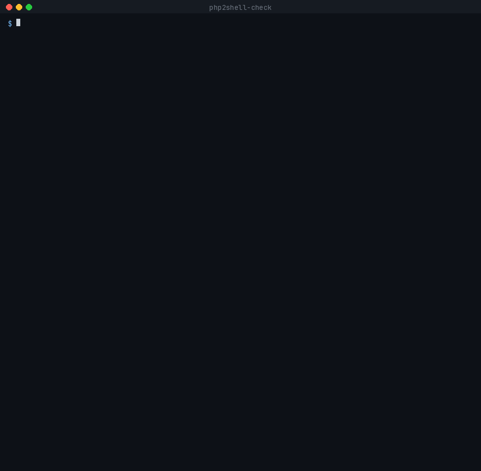
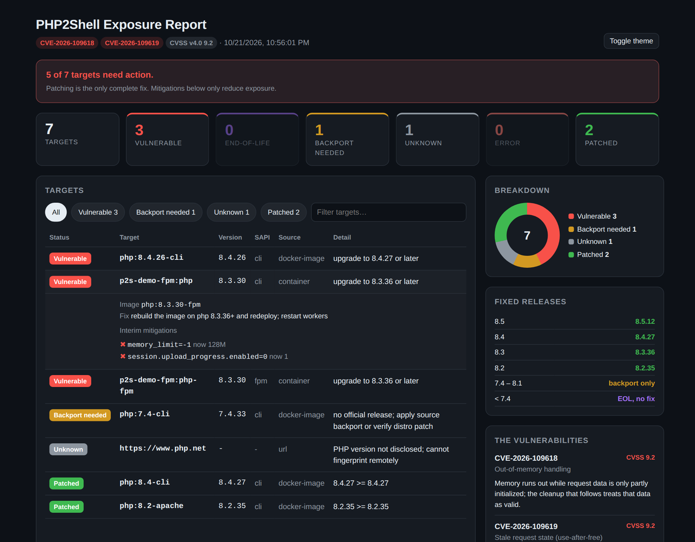
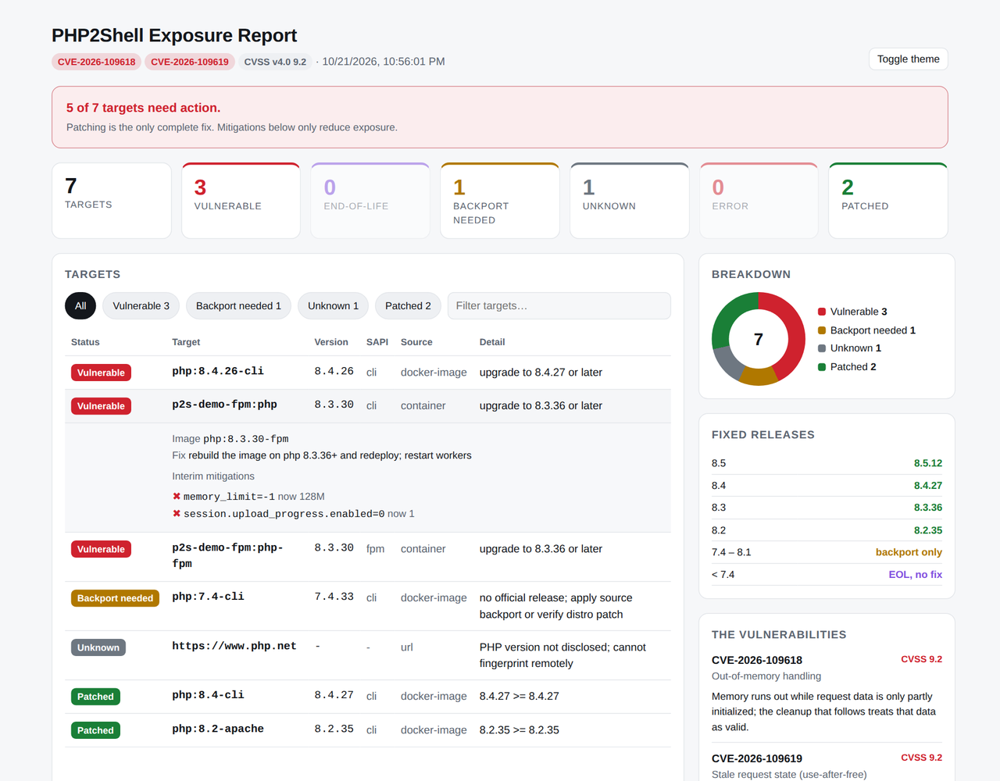

<div align="center">

# php2shell-check

**Find every PHP exposed to PHP2Shell on your machines, images, containers and fleet, in one command.**

[](https://www.npmjs.com/package/php2shell-check)
[](#what-is-php2shell)
[](#what-is-php2shell)
[](https://github.com/adityaaravind/php2shell-check/actions/workflows/test.yml)




</div>

> [!IMPORTANT]
> **Defensive tool.** No exploit code, no attack traffic. It reads PHP version and ini settings from targets you point it at. URL checks send one ordinary `HEAD` request and read a response header.

## Quick start

```bash
npx php2shell-check                                        # the PHP on this machine
npx php2shell-check --containers                           # every running container
npx php2shell-check --docker my-app:latest --html out.html # an image, plus a dashboard
```

Exits `0` when every target is patched and `1` when something needs action, so it drops straight into CI.

## Features

- **Terminal UI**: colour status pills, findings with the exact fix per target, interim-mitigation checklist, summary bar
- **Scans everything PHP lives in**
  - local binaries, auto-discovered: `php`, `php8.x`, `php-fpm*`, `php-cgi*` on `PATH` and sbin dirs
  - Docker images, before you ship them
  - running containers, probing both the CLI and PHP-FPM inside each one (their ini can differ)
  - URLs, via a passive `X-Powered-By` fingerprint
  - inventory files (CSV, TSV, JSON or plain lines) from your CMDB or asset export
- **HTML dashboard**: one self-contained file with summary cards, breakdown donut, filter and search, expandable per-target details, light and dark themes
- **CI-ready**: meaningful exit codes, `--json`, `--markdown` for PR comments and tickets, and a GitHub Action that writes a job summary
- **What-if mode**: `--define` applies ini overrides to a probe, so you can confirm mitigations take effect before rolling them out
- **Zero dependencies**: Node 18.3+, nothing else

## Install

`npx` needs no install. To put it on your `PATH` instead:

```bash
npm install -g php2shell-check
```

Published with [npm provenance](https://docs.npmjs.com/generating-provenance-statements): the tarball carries a signed attestation that it was built from this repository by GitHub Actions, which you can verify with `npm audit signatures`.

## Usage

```bash
php2shell-check                                   # discover and probe local PHP binaries
php2shell-check --docker php:8.3-fpm --docker my-app:latest
php2shell-check --containers                      # every running container
php2shell-check --container web --container worker
php2shell-check --url https://example.com
php2shell-check --inventory hosts.csv
php2shell-check 8.3.30 8.4.27                     # offline version check
php2shell-check info                              # advisory, fixed versions, mitigations
```

Combine any of these in one run. Then pick an output:

```bash
php2shell-check --containers --html report.html --open   # dashboard
php2shell-check --inventory hosts.csv --json             # machine-readable
php2shell-check --docker my-app:latest --markdown php2shell.md
```

Test whether mitigations take effect before you roll them out:

```bash
php2shell-check --docker my-app:latest \
  --define memory_limit=-1 --define session.upload_progress.enabled=0
```

### Dashboard

`--html report.html` writes a single self-contained file: no CDN, safe to attach to a ticket or email.



<details><summary>Light theme</summary>



</details>

### Inventory format

```csv
name,version
web-01,8.3.30
web-02,8.4.27
legacy-billing,7.4.33
```

Also accepted: TSV, one version per line, or JSON `[{"name": "api", "version": "8.5.11", "ini": {"memory_limit": "-1"}}]`.

### Exit codes

| Code | Meaning |
|---|---|
| `0` | every target is patched |
| `1` | at least one target needs action (vulnerable, backport needed, EOL, or unknown) |
| `2` | only errors, or nothing was scanned |

## GitHub Action

Fail the build when an image you are about to ship is exposed. The Markdown report lands in the job summary.

```yaml
- uses: adityaaravind/php2shell-check@v1
  with:
    args: --docker my-app:${{ github.sha }}
    html: php2shell-report.html          # optional
```

## How it compares

Most PHP2Shell tooling answers *"is this one URL vulnerable?"*, usually by sending probe traffic. This answers *"which of my hosts, images and containers are exposed, and what do I change on each?"* — without sending attack traffic.

| | php2shell-check | Active remote scanners | Version checkers |
|---|---|---|---|
| Local binaries | auto-discovered | — | one at a time |
| Docker images, before you ship | yes | — | — |
| Running containers | yes, CLI and FPM ini separately | — | — |
| Inventory / CMDB files | CSV, TSV, JSON | host lists | — |
| URLs | passive `X-Powered-By` hint | active probes | yes |
| ini-aware verdicts | yes, incl. `--define` what-if | — | — |
| Traffic sent per URL | one `HEAD` | multi-MiB crafted probes | one request |
| Output | TUI, HTML dashboard, JSON, Markdown | text, JSON | text, JSON |

Reach for an active remote scanner when you need to prove reachability from outside and have authorization to probe. Reach for this when you own the estate and need coverage, mitigation verification and a report you can attach to a ticket.

## What is PHP2Shell?

Two memory-safety bugs in PHP core. Details leaked on Oct 20, 2026 and fixes shipped Oct 21. Both are **CVSS v4.0 9.2** and exploitable by an **unauthenticated remote attacker**. The affected code path dates back to PHP 5.4.

| CVE | Root cause |
|---|---|
| **CVE-2026-109618** | Out-of-memory hit while request data is only partly initialized; cleanup then trusts that data as valid. |
| **CVE-2026-109619** | Use-after-free: state left over from one request points at freed memory that a later request on the same worker uses. Memory disclosure is also a confirmed impact. |

Every SAPI that serves web requests is in scope: Apache `mod_php` (highest risk), PHP-FPM, `php-cgi`, FrankenPHP, LiteSpeed.

| Branch | Fixed in | Verdict |
|---|---|---|
| 8.5 | **8.5.12** | `PATCHED` / `VULNERABLE` |
| 8.4 | **8.4.27** | `PATCHED` / `VULNERABLE` |
| 8.3 | **8.3.36** | `PATCHED` / `VULNERABLE` |
| 8.2 | **8.2.35** | `PATCHED` / `VULNERABLE` |
| 7.4 – 8.1 | source backports only, no official release | `BACKPORT` |
| < 7.4 | end-of-life, no fix | `EOL` |

### Interim mitigations

**Patching is the only complete fix.** These reduce exposure while you roll out upgrades:

| CVE | Setting |
|---|---|
| CVE-2026-109618 | `memory_limit=-1`, set so applications cannot override it |
| CVE-2026-109619 | `session.upload_progress.enabled=0` |
| CVE-2026-109619 (8.5 only) | `fatal_error_backtraces=0` |

Restart **all** PHP workers afterwards. Container memory limits and WAF rules are stopgaps, not mitigations.

## Caveats

- **Distro packages backport fixes without bumping the version.** Ubuntu, Debian, RHEL and others may ship a fixed build that still reports an older version. Confirm against your vendor's advisory.
- **URL checks are a hint, not a verdict.** `X-Powered-By` is often hidden (good) and can be stale or spoofed. Run the tool on the host for a real answer.
- **The ini a probe sees is the ini that binary loads.** `php` and `php-fpm` can read different files, which is why containers are probed with both. For Apache `mod_php`, confirm with a `phpinfo()` served by Apache.
- **Don't run random "PoC" repos.** Unverified exploit code for these CVEs is circulating, and some of it may carry malware.

## Development

```bash
npm test                                          # node:test, no dependencies
docker run -d --name p2s-demo-fpm php:8.3.30-fpm  # demo target
python3 demo/make_gif.py                          # regenerate demo/demo.gif (Pillow)
python3 docs/make_social_card.py                  # regenerate docs/social-card.png
```

## Sources

- **Upstream advisories, authoritative:** [GHSA-w8hw-w9fx-j79w](https://github.com/php/php-src/security/advisories/GHSA-w8hw-w9fx-j79w) (CVE-2026-109618) · [GHSA-6wmf-4rv5-p3rp](https://github.com/php/php-src/security/advisories/GHSA-6wmf-4rv5-p3rp) (CVE-2026-109619)
- [Tenable: PHP2Shell FAQ](https://www.tenable.com/blog/php2shell-cve-2026-109618-cve-2026-109619-frequently-asked-questions-about-critical-php-remote)
- [Qualys: PHP announces critical security release](https://blog.qualys.com/vulnerabilities-threat-research/2026/10/20/php-announces-critical-security-release-for-two-vulnerabilities)
- [Rapid7 ETR](https://www.rapid7.com/blog/post/etr-cve-2026-109618-and-cve-2026-109619-critical-unauthenticated-remote-code-execution-in-php/)
- [Huntress rapid response](https://www.huntress.com/blog/php2shell-leaked-critical-php-vulnerabilities)
- [php.net](https://www.php.net/), always the authoritative source for versions

## License

MIT © Aditya Aravind. Provided as-is for defensive use; verify findings against official advisories.
